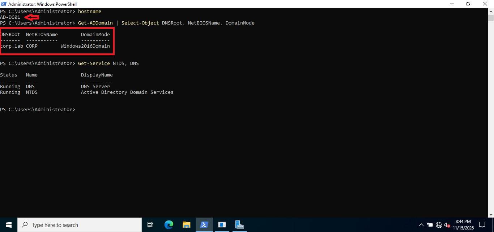
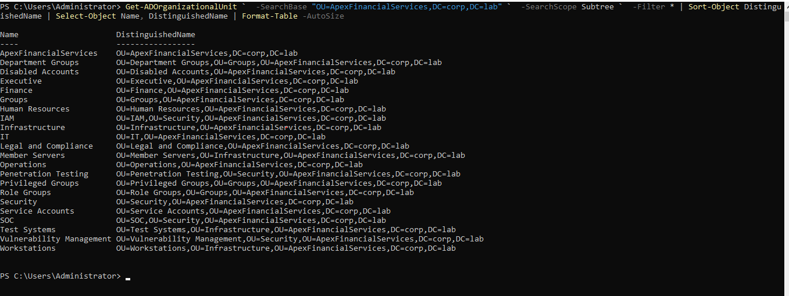
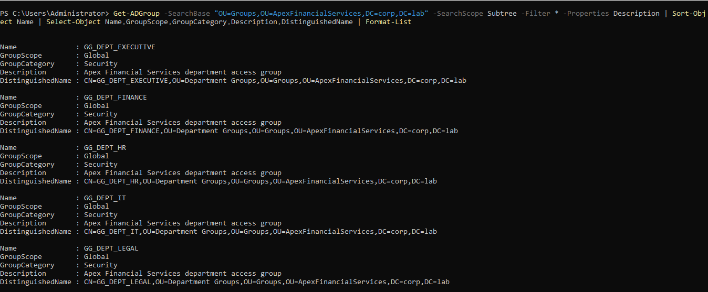
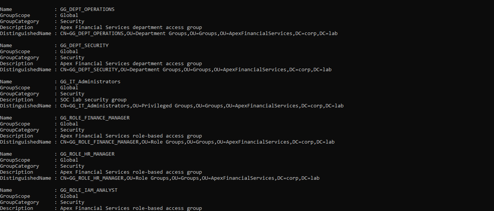

# IAM-001 — Assessing and Managing Enterprise Active Directory Organizational Structure

## 1. Exercise Overview

| Attribute | Details |
|---|---|
| Exercise ID | IAM-001 |
| Category | Identity and Access Management |
| Role Simulated | IAM Analyst |
| Organization | Apex Financial Services (AFS) |
| Domain | `corp.lab` |
| Domain Controller | AD-DC01 |
| Platform | Windows Server 2022 / Active Directory |
| Tools | PowerShell, Active Directory PowerShell Module |
| Assessment Type | Read-only directory assessment |
| Status | In Progress |
| Authorization | Authorized isolated training environment |

## 2. Business Objective

Assess the existing enterprise Active Directory organizational structure to determine whether employee identities, security teams, infrastructure and supporting directory objects are organized according to the approved organizational design.

The assessment simulates an IAM Analyst responsibility involving directory administration, identity governance, organizational structure reviews and the identification of configuration discrepancies.

## 3. Business Scenario

Apex Financial Services requires its Active Directory environment to reflect its organizational structure and support centralized identity administration.

As part of an IAM directory review, the analyst is tasked with:

- Reviewing the existing departmental OU hierarchy.
- Identifying where organizational identities are stored.
- Reviewing supporting infrastructure and security group structures.
- Comparing the implemented directory against the approved organizational design.
- Documenting discrepancies and recommending appropriate corrective action.

The assessment must be completed without making unauthorized directory changes.

## 4. Scope and Authorization

### In Scope

- AFS organizational root OU.
- Departmental organizational units.
- Security subdepartment OUs.
- Infrastructure OUs.
- Security group organizational units.
- Service Accounts OU.
- Disabled Accounts OU.
- Directory object placement.

### Out of Scope

- Creating or deleting directory objects.
- Moving or renaming users and groups.
- Modifying group memberships.
- Changing Group Policy.
- Modifying permissions or ACLs.
- Changing authentication configurations.

All activities are restricted to the authorized AFS VirtualBox lab.

## 5. Tools and Prerequisites

| Tool | Purpose |
|---|---|
| Windows PowerShell | Directory administration and assessment |
| Active Directory PowerShell Module | Querying AD objects |
| Active Directory Domain Services | Centralized directory infrastructure |
| ADUC | Graphical directory inspection |

Prerequisites:

- Administrative access to AD-DC01.
- Operational `corp.lab` domain.
- Active Directory PowerShell module.
- Approved AFS Master Project Blueprint v1.1.

## 6. Initial Environment Verification

### Step 1 — Confirming the Active Directory Environment

**Business purpose:** Establish that the directory infrastructure is available before performing an administrative assessment.

**System:** AD-DC01

**Commands executed:**

```powershell
hostname

Get-ADDomain | Select-Object DNSRoot, NetBIOSName, DomainMode

Get-Service NTDS, DNS
```

### Actual Results



| Check | Observed Result |
|---|---|
| Hostname | AD-DC01 |
| DNS domain | corp.lab |
| NetBIOS name | CORP |
| Domain mode | Windows2016Domain |
| NTDS service | Running |
| DNS service | Running |

### Analysis

The domain controller hostname and domain details matched the established AFS lab configuration.

Both Active Directory Domain Services and DNS were observed in the Running state.

**Verification:** PASSED.

**Evidence:** PowerShell command output captured during execution.

**Limitation:** This check does not independently validate DNS resolution, replication health or workstation connectivity.

## 7. Enterprise Directory Structure Assessment

### Step 2 — Reviewing the Company's Organizational Structure

**Business purpose:** Identify how the organization is represented within Active Directory and determine whether the directory hierarchy reflects the approved enterprise design.

**System:** AD-DC01

**Command executed:**

```powershell
Get-ADOrganizationalUnit `
  -SearchBase "OU=ApexFinancialServices,DC=corp,DC=lab" `
  -SearchScope Subtree `
  -Filter * |
Sort-Object DistinguishedName |
Select-Object Name, DistinguishedName |
Format-Table -AutoSize
```

### Actual Results



The command successfully returned 22 OU objects:

- 1 AFS root OU.
- 21 descendant OUs.
- 4 Security subdepartment OUs.
- 3 Infrastructure child OUs.
- 3 Groups child OUs.

### Observed Organizational Structure

```text
ApexFinancialServices
│
├── Executive
├── Finance
├── Human Resources
├── IT
├── Legal and Compliance
├── Operations
│
├── Security
│   ├── IAM
│   ├── Penetration Testing
│   ├── SOC
│   └── Vulnerability Management
│
├── Infrastructure
│   ├── Member Servers
│   ├── Test Systems
│   └── Workstations
│
├── Groups
│   ├── Department Groups
│   ├── Privileged Groups
│   └── Role Groups
│
├── Service Accounts
└── Disabled Accounts
```

### Architecture Finding

**Finding:** The implemented OU hierarchy differs from the approved AFS blueprint.

The blueprint specifies a `Departments` parent OU containing all departmental OUs. In the actual environment, the departmental OUs are located directly beneath `ApexFinancialServices`.

The Security subdepartment OUs are correctly nested beneath Security.

### Analysis

The difference represents an organizational design deviation. It is not, by itself, evidence of a security vulnerability.

Potential implications include:

- Differences in Group Policy inheritance and targeting.
- Organizational administration and delegation design.
- Consistency between documented and implemented directory architecture.

Further assessment is required before deciding whether restructuring is necessary.

**Verification:** PASSED — OU inventory retrieved successfully.

**Configuration changes:** None.

**Remediation decision:** Deferred pending architecture review.

**Evidence:** Actual PowerShell output and GitHub exercise record.

## 8. Reviewing Enterprise Security Groups

### Step 3 — Reviewing Departmental, Role-Based and Privileged Groups

**Business purpose:** Assess how enterprise security groups are organized and documented to support identity administration, role-based access management and privileged access governance.

**System:** AD-DC01

**Tool:** Active Directory PowerShell Module

#### Command Executed

```powershell
Get-ADGroup -SearchBase "OU=Groups,OU=ApexFinancialServices,DC=corp,DC=lab" -SearchScope Subtree -Filter * -Properties Description | Sort-Object Name | Select-Object Name,GroupScope,GroupCategory,Description,DistinguishedName | Format-List
```

#### Actual Results




The command successfully retrieved 16 security groups.

| Group classification | Count |
|---|---:|
| Department groups | 7 |
| Role groups | 6 |
| Existing SOC and standard-user groups | 2 |
| Privileged groups | 1 |
| Total | 16 |

All returned groups were identified as Global Security groups.

#### Findings

**Finding 1 — Consistent group classification**

All 16 groups use Global scope and Security category.

This establishes a consistent group classification across the retrieved inventory. Membership and effective permissions have not yet been assessed.

**Finding 2 — Generic and outdated group descriptions**

The following groups contain descriptions requiring administrative review:

- `GG_IT_Administrators` — Description references SOC lab security rather than its IT administrative purpose.
- `GG_SOC_Analysts` — Description is generic and does not explain the group's specific access purpose.
- `GG_Standard_Users` — Description contains legacy SOC lab wording.

Other department and role groups also use generic descriptions. More specific descriptions should identify their intended business purpose.

**Finding 3 — Vulnerability Analyst group identified**

`GG_ROLE_VULN_ANALYST` exists under the Role Groups OU.

**Finding 4 — Vulnerability Engineer group not identified**

No `GG_ROLE_VULN_ENGINEER` group appeared in the retrieved inventory.

This is a potential gap against the expanded AFS role design. No group creation is authorized under this assessment.

**Finding 5 — Privileged group organization**

`GG_IT_Administrators` is stored under the Privileged Groups OU.

Its actual membership, effective privileges and resource permissions have not yet been verified.

#### Security and Governance Analysis

Accurate group naming, classification and descriptions support access governance, directory administration and auditability.

Generic descriptions can make it harder for administrators and auditors to understand a group's intended purpose.

The presence of a group under a Privileged Groups OU does not, by itself, prove that it has administrative privileges.

#### Verification

**PASSED** — The group inventory was retrieved successfully.

- Total groups returned: 16.
- All returned groups: Global Security.
- Group descriptions retrieved.
- Existing Vulnerability Analyst group identified.
- Proposed Vulnerability Engineer group not identified.

**Configuration changes:** None.

**Remediation:** Deferred pending group membership and access-design reviews.


## 9. Reviewing Employee and Computer Account Placement

### Step 4 — Examining Identity and Infrastructure Object Locations

**Business purpose:** Determine whether employee identities and computer accounts are stored in their intended organizational locations.

Planned assessment:

- Review employee account locations.
- Review department attributes.
- Review computer account locations.
- Identify unexpected or inconsistent object placement.

**Status:** Pending execution.

## 10. Comparing the Directory Against the Approved Architecture

### Step 5 — Assessing Organizational Design Compliance

Compare the actual directory hierarchy and object placement against AFS Master Project Blueprint v1.1.

Review:

- Departmental organization.
- Security subdepartment organization.
- Infrastructure organization.
- Group storage locations.
- Service account separation.
- Disabled account organization.

**Status:** In Progress.

**Known deviation:** Missing `Departments` parent OU.

## 11. Documenting Findings and Administrative Recommendations

### Step 6 — Preparing the IAM Assessment Record

Document:

- Verified directory structures.
- Observed deviations.
- Supporting evidence.
- Administrative implications.
- Recommended corrective actions.
- Outstanding questions and limitations.

No remediation will be performed without an approved change decision.

**Status:** Pending completion of the assessment.

## 12. Security and Governance Analysis

This exercise demonstrates how an IAM Analyst can use Active Directory PowerShell to inspect directory organization and support identity governance.

A structured directory hierarchy contributes to:

- Centralized identity administration.
- Organizational consistency.
- Group Policy administration.
- Delegated administration planning.
- Identity lifecycle management.

The inventory alone does not prove effective permissions, successful policy application or the absence of excessive privileges.

## 13. Limitations

- Assessment is restricted to the AFS training domain.
- Directory structure does not independently establish effective user permissions.
- No production enterprise deployment is represented.
- Group Policy application and delegated administrative rights require separate testing.
- Findings are limited to the evidence collected.

## 14. Cleanup and Rollback

No cleanup or rollback is required.

All completed assessment steps were read-only. No Active Directory configuration changes were made.

## 15. Conclusion and Exercise Status

**Current status: IN PROGRESS**

Completed:

- Verified domain controller identity and domain information.
- Confirmed NTDS and DNS service states.
- Retrieved the existing OU hierarchy.
- Identified a discrepancy between the implemented directory and approved architecture.

Pending:

- Security group inventory.
- Employee and computer account placement review.
- Completion of architecture assessment.
- Final recommendations and verification.

This exercise will be marked completed after all planned assessment activities, evidence collection and final documentation have been reviewed.

## 16. References

- AFS Enterprise Cybersecurity Lab Master Project Blueprint v1.1.
- Microsoft Active Directory Domain Services documentation.
- Microsoft Active Directory PowerShell module documentation.
- Microsoft Group Policy documentation.
The exercise will be marked completed only after execution, evidence collection, verification and documentation.

## 15. References

- AFS Enterprise Cybersecurity Lab Master Blueprint v1.1.
- Microsoft Active Directory Domain Services documentation.
- Microsoft Group Policy documentation.
