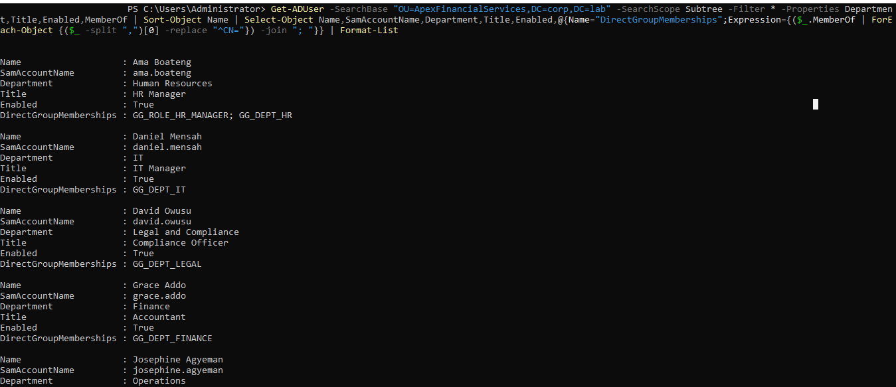
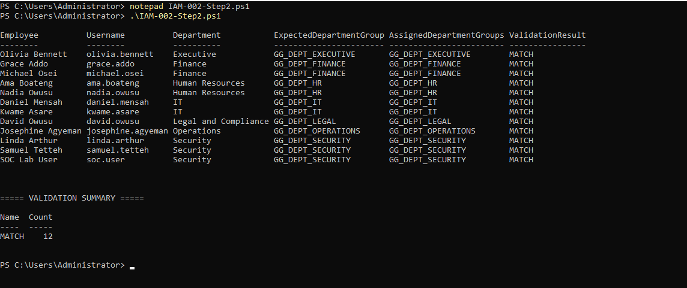

## Step 1 — Inventorying Employee Security Group Memberships

### Business Purpose

Conduct an employee group membership inventory to establish how Active Directory security groups are assigned across the organization.

The objective is to create a baseline for reviewing departmental access, role-based assignments and privileged access governance.

**Execution date:** 16 November 2026

**System:** AD-DC01

**Domain:** corp.lab

**Tool:** Active Directory PowerShell Module

### Command Executed

```powershell
Get-ADUser -SearchBase "OU=ApexFinancialServices,DC=corp,DC=lab" -SearchScope Subtree -Filter * -Properties Department,Title,Enabled,MemberOf | Sort-Object Name | Select-Object Name,SamAccountName,Department,Title,Enabled,@{Name="DirectGroupMemberships";Expression={($_.MemberOf | ForEach-Object {($_ -split ",")[0] -replace "^CN="}) -join "; "}} | Format-List
```

### Actual Results



The command successfully returned 12 employee accounts and 19 direct group membership assignments.

| Attribute | Observed result |
|---|---:|
| Employee accounts retrieved | 12 |
| Enabled accounts | 12 |
| Disabled accounts | 0 |
| Direct group memberships reported | 19 |
| Departments represented | 7 |

### Employee Group Membership Summary

| Employee | Department | Direct group memberships |
|---|---|---|
| Ama Boateng | Human Resources | GG_DEPT_HR, GG_ROLE_HR_MANAGER |
| Daniel Mensah | IT | GG_DEPT_IT |
| David Owusu | Legal and Compliance | GG_DEPT_LEGAL |
| Grace Addo | Finance | GG_DEPT_FINANCE |
| Josephine Agyeman | Operations | GG_DEPT_OPERATIONS |
| Kwame Asare | IT | GG_DEPT_IT, GG_ROLE_SYSTEM_ADMIN |
| Linda Arthur | Security | GG_DEPT_SECURITY, GG_ROLE_IAM_ANALYST |
| Michael Osei | Finance | GG_DEPT_FINANCE, GG_ROLE_FINANCE_MANAGER |
| Nadia Owusu | Human Resources | GG_DEPT_HR |
| Olivia Bennett | Executive | GG_DEPT_EXECUTIVE |
| Samuel Tetteh | Security | GG_DEPT_SECURITY, GG_ROLE_PENTESTER |
| Kofi Mensah (soc.user) | Security | GG_DEPT_SECURITY, GG_SOC_Analysts, GG_Standard_Users |

### Findings

**Finding F01 — Departmental group assignments**

All 12 retrieved employee accounts have a direct departmental group corresponding to their recorded Department attribute.

This supports the intended departmental grouping model. Resource permissions have not yet been validated.

**Finding F02 — Role-based group assignments**

Six role groups have direct employee memberships in the retrieved output.

Daniel Mensah, identified as IT Manager, has only the IT departmental group. Further review is required to determine whether his responsibilities require a dedicated role group.

**Finding F03 — Standard user group assignment**

The retained SOC account is directly assigned to GG_Standard_Users in addition to its department and SOC analyst groups.

The group's intended business scope requires clarification because its existing description references the SOC lab.

**Finding F04 — Privileged group membership**

No direct membership in GG_IT_Administrators was observed among the 12 employee accounts.

This does not establish the absence of indirect or alternative privileged access.

### Security and Governance Analysis

Group membership is a fundamental component of enterprise access administration.

Departmental groups can support organizational access assignments, while role-based groups can help align permissions with job responsibilities.

However, group membership alone does not establish effective access. Nested memberships, resource ACLs, local group assignments and other authorization mechanisms require separate assessment.

### Limitations

- The inventory uses the Active Directory MemberOf attribute.
- Primary group membership is not included in this output.
- Nested group memberships are not expanded.
- Effective resource permissions were not evaluated.
- Group ownership and business approval were not independently verified.

### Verification

**PASSED** — Employee group membership inventory retrieved successfully.

- 12 employee accounts returned.
- 19 direct group membership assignments reported.
- Departmental group assignments observed for all 12 accounts.
- Role and additional group assignments documented.
- No directory configuration changes performed.

**Configuration changes:** None.

**Remediation:** Deferred pending subsequent RBAC validation.


## Step 2 — Validating Departmental Group Assignments

### Business Purpose

Validate that employee departmental attributes correspond to their expected Active Directory departmental security group assignments.

This activity simulates an IAM Analyst performing an access governance control to identify missing, unexpected or inconsistent departmental group memberships.

**System:** AD-DC01

**Tool:** PowerShell and Active Directory PowerShell Module

### Validation Method


Import-Module ActiveDirectory

$departmentGroupMap = @{
    "Executive"             = "GG_DEPT_EXECUTIVE"
    "IT"                    = "GG_DEPT_IT"
    "Human Resources"       = "GG_DEPT_HR"
    "Finance"               = "GG_DEPT_FINANCE"
    "Security"              = "GG_DEPT_SECURITY"
    "Operations"            = "GG_DEPT_OPERATIONS"
    "Legal and Compliance"  = "GG_DEPT_LEGAL"
}

$users = Get-ADUser `
    -SearchBase "OU=ApexFinancialServices,DC=corp,DC=lab" `
    -SearchScope Subtree `
    -Filter * `
    -Properties Department,Title,Enabled,MemberOf

$results = foreach ($user in $users) {

    $directGroups = @(
        $user.MemberOf | ForEach-Object {
            (($_ -split ",")[0] -replace "^CN=")
        }
    )

    $expectedGroup = $departmentGroupMap[$user.Department]

    $assignedDepartmentGroups = @(
        $directGroups | Where-Object {
            $_ -like "GG_DEPT_*"
        }
    )

    if (-not $expectedGroup) {
        $status = "NO_DEPARTMENT_MAPPING"
    }
    elseif ($expectedGroup -notin $assignedDepartmentGroups) {
        $status = "MISSING_EXPECTED_GROUP"
    }
    elseif ($assignedDepartmentGroups.Count -gt 1) {
        $status = "MULTIPLE_DEPARTMENT_GROUPS"
    }
    else {
        $status = "MATCH"
    }

    [PSCustomObject]@{
        Employee                 = $user.Name
        Username                 = $user.SamAccountName
        Department               = $user.Department
        ExpectedDepartmentGroup  = $expectedGroup
        AssignedDepartmentGroups = $assignedDepartmentGroups -join "; "
        ValidationResult         = $status
    }
}

$results |
    Sort-Object Department,Employee |
    Format-Table -Wrap -AutoSize

Write-Host "`n===== VALIDATION SUMMARY ====="

$results |
    Group-Object ValidationResult |
    Select-Object Name,Count |
    Format-Table -AutoSize


A PowerShell script retrieved employee records from the AFS organizational unit and compared each employee's Department attribute against the approved departmental group mapping.



The script examined direct group memberships and reported the validation result for each employee.

### Departmental Group Mapping

| Department | Expected group |
|---|---|
| Executive | GG_DEPT_EXECUTIVE |
| IT | GG_DEPT_IT |
| Human Resources | GG_DEPT_HR |
| Finance | GG_DEPT_FINANCE |
| Security | GG_DEPT_SECURITY |
| Operations | GG_DEPT_OPERATIONS |
| Legal and Compliance | GG_DEPT_LEGAL |

### Actual Results

The script successfully evaluated 12 employee accounts.

| Validation result | Count |
|---|---:|
| MATCH | 12 |
| MISSING_EXPECTED_GROUP | 0 |
| MULTIPLE_DEPARTMENT_GROUPS | 0 |
| NO_DEPARTMENT_MAPPING | 0 |
| Total | 12 |

### Findings

**Finding 1 — Departmental group alignment**

All 12 employee accounts had the expected direct departmental security group based on their recorded Department attribute.

**Finding 2 — No departmental membership discrepancies reported**

The script did not identify any missing expected departmental groups or multiple direct departmental group assignments.

### Security and Governance Analysis

Consistent departmental group assignments support structured access administration and provide a foundation for role-based access governance.

However, matching departmental group membership does not independently establish appropriate resource permissions or effective access.

Additional validation is required for role-based groups, nested memberships, privileged access and resource permissions.

### Verification

**PASSED**

- Employee accounts evaluated: 12.
- Departmental group matches: 12.
- Reported discrepancies: 0.
- Active Directory changes: None.

**Assessment limitation:** Validation was limited to the departmental group mapping defined in the script and direct memberships reported by Active Directory.

### Evidence

Attach the actual PowerShell validation output and summary screenshot.

**Exercise status:** Step 2 completed and verified.
